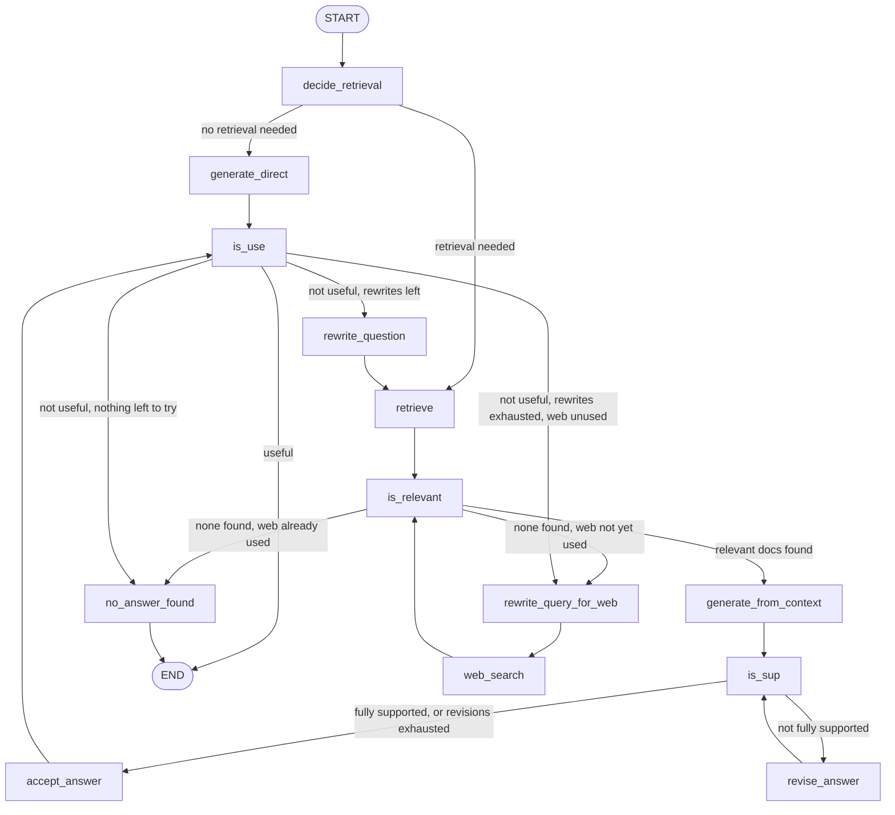

# RAGnarok | Adaptive Self-RAG Chatbot

> A modified **Self-RAG** chatbot that decides *when* to retrieve, checks its own answers for **groundedness** and **usefulness**, revises them when they drift from the sources, and escalates to **web search** only when local context is weak.

[**Live Demo**](https://adaptive-self-rag-chatbot-1.streamlit.app/) · [**GitHub**](https://github.com/Aryan-0-1/RAGnarok-Adaptive-Self-RAG-ChatBot)


---

## Why this project exists

A standard RAG pipeline is a straight line: **retrieve top-K → generate**. It never asks whether the retrieved chunks are relevant, whether the answer is actually supported by them, or whether the answer even addresses the question. That is where hallucinations come from.

RAGnarok turns that straight line into a **graph with feedback loops**. Every stage is a LangGraph node, and conditional edges route the flow based on structured LLM judgments:

| Question | Node that answers it |
|---|---|
| Do I even need the documents for this? | `decide_retrieval` |
| Are these chunks about the right topic? | `is_relevant` |
| Is every claim in my answer backed by the context? | `is_sup` (IsSUP) |
| Did I actually answer what was asked? | `is_use` (IsUSE) |
| Is the local knowledge base enough, or do I need the web? | retry-then-fallback routing |

---

## Key features

- **Adaptive retrieval.** Simple general-knowledge questions skip retrieval entirely and are answered directly.
- **Relevance filtering.** Each retrieved chunk is graded individually, so irrelevant chunks never reach the generator.
- **Hallucination-mitigation loop.** Each draft answer is graded `fully_supported`, `partially_supported` or `no_support`. Anything short of fully supported is revised into a quote-only answer and re-checked, up to 5 times.
- **Usefulness check.** A separate grader decides whether the answer actually addresses the question, independent of grounding.
- **Retry-then-fallback retrieval.** Weak answers first trigger free local query rewrites. Tavily web search is used only after local retries are exhausted, and at most once per question.
- **Multi-source ingestion.** PDFs, YouTube transcripts and live web results all flow into the same grounded pipeline.
- **Transparent by design.** A live node-by-node progress trail while the graph runs, plus a "View Self-RAG Details" panel showing the answer source, IsSUP/IsUSE verdicts, evidence quotes, queries used and the raw excerpts.
- **Persistent chat threads.** Conversations and their loaded sources are stored in SQLite and can be resumed.
- **Graceful degradation.** A missing Google or Tavily key disables that feature with a banner instead of crashing the app.

---

## Architecture



The live version of this diagram is also rendered in the app sidebar, generated directly from the compiled graph, so it cannot drift out of sync with the code.

### Node reference

| Node | What it does |
|---|---|
| `decide_retrieval` | LLM decides whether the question needs the loaded sources. Defaults to retrieving when unsure. |
| `generate_direct` | Answers from general knowledge only. Says "I don't know" rather than guess about source-specific facts. |
| `retrieve` | Top-K similarity search over FAISS, using the rewritten query if one exists. |
| `is_relevant` | Topic-level relevance grading per chunk. Shared by local and web results. |
| `generate_from_context` | Answers using only the relevant chunks and records whether the context was local or web. |
| `is_sup` | Strict groundedness check returning a verdict and up to 3 evidence quotes. |
| `revise_answer` | Rewrites the answer as direct quotes from the context to force grounding. |
| `accept_answer` | Pass-through node that keeps the routing diagram readable. |
| `is_use` | Checks that the answer addresses the question, without re-checking grounding. |
| `rewrite_question` | Produces a short, entity-preserving query for another local retrieval attempt. |
| `rewrite_query_for_web` | Converts the question into a keyword query for Tavily. |
| `web_search` | Calls Tavily and wraps results as `Document`s tagged `source="web"`. |
| `no_answer_found` | Returns "No answer found." rather than guessing. |

### Fallback strategy (cheapest first)

1. **Local rewrite retries** reuse the existing index, cost nothing extra and run first, up to `MAX_REWRITE_TRIES` (3).
2. **Web search** runs only when no relevant local documents exist, or after local retries are exhausted and the answer is still not useful.
3. **One web call per question.** The `web_search_used` flag bounds external API cost and prevents loops.
4. **Honest failure.** If web results also fail the checks, the system returns "No answer found." instead of a confident guess.

A global `recursion_limit` of 80 acts as a final safety net.

---

## Tech stack

| Layer | Choice |
|---|---|
| Orchestration | LangGraph (`StateGraph` with conditional edges) |
| Chat LLM | `openai/gpt-oss-120b` via Groq (`langchain-groq`), temperature 0 |
| Structured judgments | `llm.with_structured_output(...)` with Pydantic schemas |
| Embeddings | Google `models/gemini-embedding-001` |
| Vector store | FAISS (in-memory) |
| Chunking | `RecursiveCharacterTextSplitter`, 600 characters with 150 overlap |
| Retrieval | Top-K = 4 |
| Web search | Tavily |
| Ingestion | `PyPDFLoader`, `youtube-transcript-api` |
| UI | Streamlit with `stream_mode="updates"` for live step tracking |
| Persistence | SQLite (threads, messages, sources) |

### Default pipeline configuration

| Parameter | Value |
|---|---|
| Chunk size / overlap | 600 / 150 |
| Top-K retrieval | 4 |
| Max IsSUP revisions | 5 |
| Max local rewrite tries | 3 |
| Web-search fallback | Enabled when `TAVILY_API_KEY` is set |
| Embedding batch size / retries | 50 / 3, with exponential backoff |

All of these live in `selfrag/config.py`.

---

## Project structure

```
selfrag/                    # Backend package
  config.py                 # Env/secrets loading, constants, feature-ready flags
  llm.py                    # Chat LLM setup (Groq)
  embeddings.py             # Google embeddings with batching and exponential backoff
  vectorstore.py            # FAISS store: add_documents / clear_documents / get_retriever
  chat_store.py             # SQLite persistence for threads, messages and sources
  graph/
    state.py                # State TypedDict and Pydantic schemas for structured output
    nodes.py                # All node functions and their prompts
    routing.py              # All conditional-edge routing functions
    build.py                # Builds and compiles the StateGraph, exposes `app`

ui/                         # Streamlit UI package
  sidebar.py                # Config summary, workflow diagram, source upload, thread list
  chat.py                   # Session state, thread switching, history, input handling
  streaming.py              # app.stream() wrapper and node-to-label mapping
  details.py                # "View Self-RAG Details" expander

frontend_self_rag.py        # Streamlit entrypoint
requirements.txt
```

---

## Getting started

### Prerequisites

- Python 3.10+
- A [Groq API key](https://console.groq.com) for the chat model
- A [Google AI Studio API key](https://aistudio.google.com/apikey) for embeddings (free tier works)
- *(Optional)* A [Tavily API key](https://app.tavily.com) for the web-search fallback

### Installation

```bash
git clone https://github.com/Aryan-0-1/RAGnarok-Adaptive-Self-RAG-ChatBot.git
cd RAGnarok-Adaptive-Self-RAG-ChatBot

python -m venv .venv
source .venv/bin/activate          # Windows: .venv\Scripts\activate

pip install -r requirements.txt
```

### Configuration

Create a `.env` file in the project root:

```env
# Chat LLM (required)
GROQ_API_KEY=your_groq_key
GROQ_CHAT_MODEL=openai/gpt-oss-120b

# Embeddings (required for document retrieval)
GOOGLE_API_KEY=your_google_key
# GOOGLE_EMBED_MODEL=models/gemini-embedding-001

# Web-search fallback (optional)
TAVILY_API_KEY=your_tavily_key

# Chat history database (optional)
# CHAT_DB_PATH=self_rag_chat_history.sqlite3

# LangSmith tracing (optional)
# LANGCHAIN_TRACING_V2=true
# LANGCHAIN_API_KEY=your_langsmith_key
# LANGCHAIN_PROJECT=RAGnarok
```

| Variable | Required | Purpose |
|---|---|---|
| `GROQ_API_KEY` | Yes | Authenticates the chat LLM |
| `GROQ_CHAT_MODEL` | Yes | Chat model name, e.g. `openai/gpt-oss-120b` |
| `GOOGLE_API_KEY` | Yes, for retrieval | Embeddings |
| `GOOGLE_EMBED_MODEL` | No | Defaults to `models/gemini-embedding-001` |
| `GOOGLE_EMBED_BATCH_SIZE` | No | Chunks per embedding call, default 50 |
| `GOOGLE_EMBED_MAX_RETRIES` | No | Retries per batch, default 3 |
| `TAVILY_API_KEY` | No | Enables the web fallback |
| `CHAT_DB_PATH` | No | SQLite file for chat persistence |
| `LANGCHAIN_*` | No | Optional LangSmith tracing |

Configuration is read from Streamlit `st.secrets` first, then environment variables, so the same code works locally and on Streamlit Community Cloud.

### Run

```bash
streamlit run frontend_self_rag.py
```

---

## Usage

1. **Add sources.** Upload a PDF or paste a YouTube URL in the sidebar and click **Add**.
2. **Ask a question.** Watch the live status as the graph executes: retrieval decision, retrieval, relevance filtering, grounding check, revisions, usefulness check and, if needed, web search.
3. **Inspect the answer.** Expand **View Self-RAG Details** to see where the answer came from (general knowledge, your documents or the web), the IsSUP and IsUSE verdicts, supporting evidence, the queries used and the raw excerpts.
4. **Manage threads.** Start a **New Chat** or resume any earlier thread, including its history and loaded sources.

### Example behaviors

| Question type | What happens |
|---|---|
| "What is overfitting?" (general knowledge) | `decide_retrieval` skips retrieval and the answer comes from general knowledge. |
| A fact stated in your PDF | Retrieve, filter, generate, verify grounding, verify usefulness, then answer from your documents. |
| A vague question that retrieves poorly | `is_use` flags it as not useful and the query is rewritten and re-retrieved up to 3 times. |
| A question your documents cannot answer | After local attempts fail, Tavily web search runs and its results go through the same checks. |
| A question nothing can answer | "No answer found." rather than a fabricated answer. |

---

## Design decisions

- **Structured outputs for every judgment.** Routing reads typed fields (`Literal`, `bool`) instead of parsing free text, which keeps control flow deterministic.
- **One shared `is_relevant` node for local and web results.** Relevance judgment is identical either way, so web results are tagged `source="web"` instead of getting a duplicate node.
- **Topic-level relevance, strict grounding.** The relevance filter is deliberately lenient so useful chunks survive, and `IsSUP` is deliberately strict so unsupported claims do not.
- **Separate grounding and usefulness checks.** An answer can be fully grounded and still not answer the question, so the two are graded independently.
- **Cheapest fallback first.** Local rewrites are free, so they run before paid web search, which is capped at one call per question.
- **Fail honestly.** Returning "No answer found." is preferred over a confident wrong answer.


---

## Author

**Aryan Choudhary**
GitHub: [@Aryan-0-1](https://github.com/Aryan-0-1)

---

If you found this project useful, consider giving it a ⭐. Suggestions and contributions are welcome.
